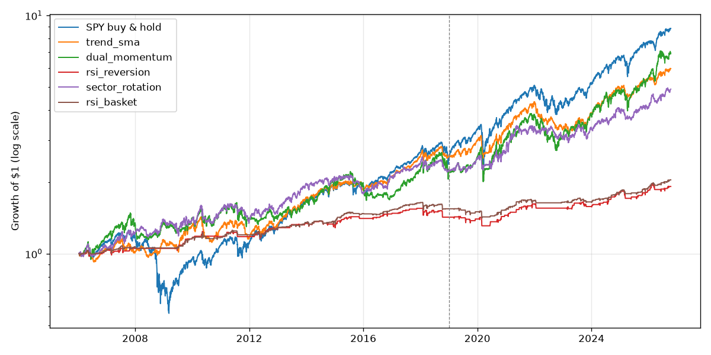

# Backtest 2026-10-13

Data: 2006-01-13 to 2026-10-13, daily adjusted closes. Costs: 0.05% per trade.
In-sample: before 2019-01-01. Out-of-sample: 2019-01-01 onward. Trades are over the full period.

| Strategy | Period | Total | CAGR | Sharpe | Max drawdown | Volatility | Trades |
|---|---|---|---|---|---|---|---|
| SPY buy & hold | in-sample | 153% | 7.4% | 0.47 | -55.2% | 19.2% | - |
| trend_sma | in-sample | 157% | 7.6% | 0.67 | -21.9% | 12.0% | 126 |
| dual_momentum | in-sample | 121% | 6.3% | 0.47 | -24.3% | 15.9% | 59 |
| rsi_reversion | in-sample | 42% | 2.8% | 0.49 | -8.2% | 5.9% | 320 |
| sector_rotation | in-sample | 124% | 6.4% | 0.55 | -17.4% | 13.0% | 492 |
| rsi_basket | in-sample | 54% | 3.4% | 0.65 | -6.8% | 5.4% | 813 |
| SPY buy & hold | out-of-sample | 249% | 17.5% | 0.93 | -33.7% | 19.2% | - |
| trend_sma | out-of-sample | 133% | 11.5% | 0.90 | -27.2% | 13.1% | 126 |
| dual_momentum | out-of-sample | 213% | 15.8% | 0.81 | -30.0% | 20.7% | 59 |
| rsi_reversion | out-of-sample | 34% | 3.9% | 0.63 | -8.7% | 6.4% | 320 |
| sector_rotation | out-of-sample | 119% | 10.6% | 0.79 | -15.2% | 13.9% | 492 |
| rsi_basket | out-of-sample | 32% | 3.7% | 0.69 | -9.3% | 5.5% | 813 |

