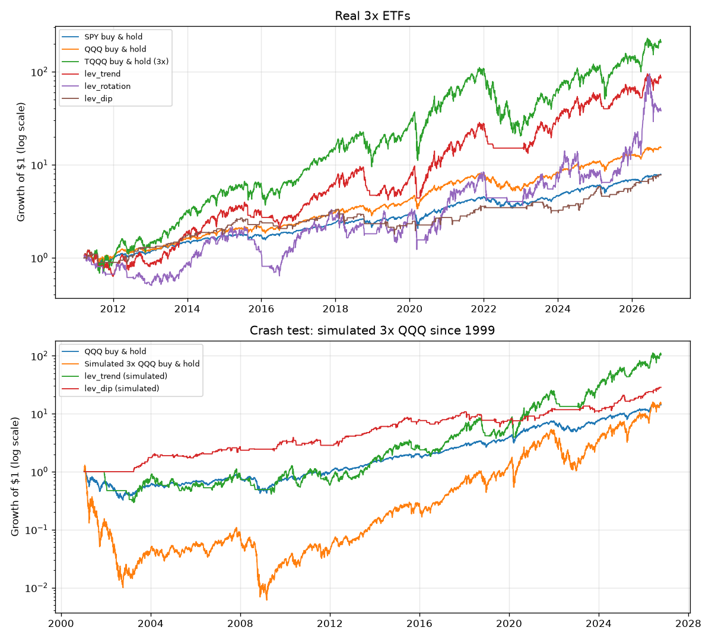

# Aggressive lab backtest 2026-10-13

Paper-only experiments. 3x ETFs move three times the index each day, both ways.
Costs: 0.05% per trade. "$100→$1,000 in 5y" is the share of all 5-year windows (start dates every week)
where the account reached 10x at some point; "Fell to $50" is the share where it dropped to half its start at some point.

## 1. Real leveraged ETF prices (2011-03-22 to 2026-10-13)

| Strategy | Total | CAGR | Sharpe | Max drawdown | $100→$1,000 in 5y | Fell to $50 | Trades |
|---|---|---|---|---|---|---|---|
| SPY buy & hold | 686% | 14.2% | 0.87 | -33.7% | 0% | 0% | - |
| QQQ buy & hold | 1,428% | 19.2% | 0.95 | -35.1% | 0% | 0% | - |
| TQQQ buy & hold (3x) | 20,551% | 40.9% | 0.87 | -81.7% | 24% | 16% | - |
| lev_trend | 8,467% | 33.2% | 0.85 | -56.2% | 6% | 3% | 87 |
| lev_rotation | 3,688% | 26.4% | 0.69 | -70.5% | 4% | 21% | 186 |
| lev_dip | 677% | 14.1% | 0.67 | -45.8% | 0% | 0% | 270 |

In-sample before 2019-01-01, out-of-sample after:

| Strategy | Period | CAGR | Sharpe | Max drawdown |
|---|---|---|---|---|
| SPY buy & hold | in-sample | 11.0% | 0.79 | -19.3% |
| SPY buy & hold | out-of-sample | 17.5% | 0.93 | -33.7% |
| QQQ buy & hold | in-sample | 15.3% | 0.92 | -22.8% |
| QQQ buy & hold | out-of-sample | 23.2% | 0.99 | -35.1% |
| TQQQ buy & hold (3x) | in-sample | 37.1% | 0.88 | -58.1% |
| TQQQ buy & hold (3x) | out-of-sample | 44.9% | 0.88 | -81.7% |
| lev_trend | in-sample | 22.0% | 0.69 | -50.9% |
| lev_trend | out-of-sample | 45.4% | 0.99 | -54.9% |
| lev_rotation | in-sample | 7.9% | 0.40 | -70.5% |
| lev_rotation | out-of-sample | 47.9% | 0.90 | -69.4% |
| lev_dip | in-sample | 11.5% | 0.60 | -29.6% |
| lev_dip | out-of-sample | 16.8% | 0.75 | -26.6% |

## 2. Crash test with simulated 3x QQQ (2001-01-12 to 2026-10-13)

Covers the 2000–2002 dot-com crash and 2008. The simulated fund uses QQQ's daily moves x3 minus 2.5%/yr for fees and borrowing. Where both exist, real TQQQ returned 41.2%/yr and the simulation 44.7%/yr.

| Strategy | Total | CAGR | Sharpe | Max drawdown | $100→$1,000 in 5y | Fell to $50 | Trades |
|---|---|---|---|---|---|---|---|
| QQQ buy & hold | 1,324% | 10.9% | 0.55 | -70.4% | 0% | 4% | - |
| Simulated 3x QQQ buy & hold | 1,379% | 11.1% | 0.51 | -99.5% | 19% | 40% | - |
| lev_trend (simulated) | 10,316% | 19.8% | 0.63 | -70.9% | 5% | 8% | 175 |
| lev_dip (simulated) | 2,753% | 13.9% | 0.69 | -45.2% | 0% | 0% | 398 |

